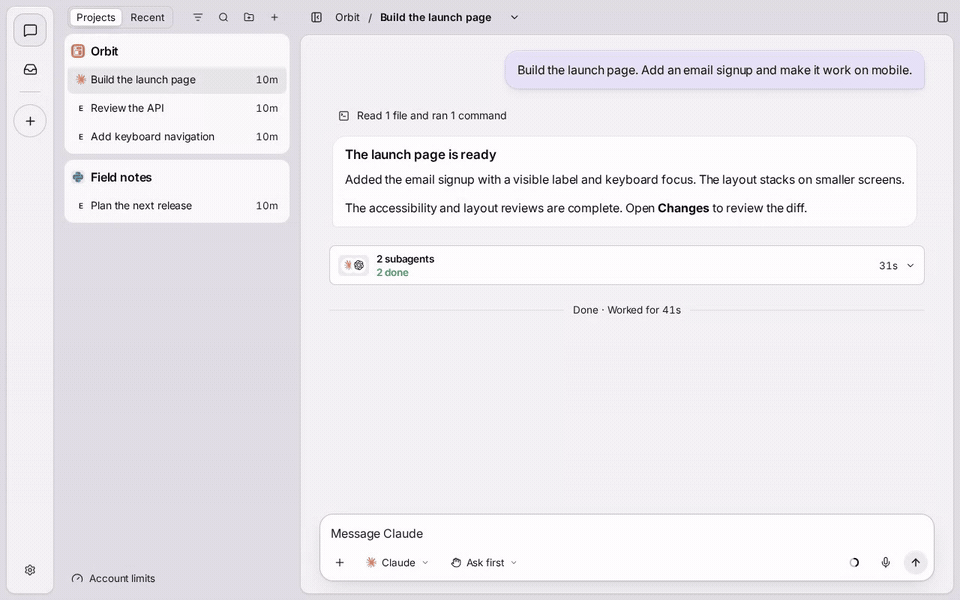

<p align="center">
  
</p>
<h1 align="center">boite <sub>[bwat]</sub></h1>
<p align="center">
  An agentic development environment (ADE) for the coding agents you already use.
</p>
<p align="center">
  <a href="https://github.com/mtsu-dev/boite/releases">Download</a> ·
  <a href="docs/README.md">Documentation</a> ·
  <a href="docs/server.md">Self-host</a>
</p>

<picture>
  <source media="(prefers-color-scheme: dark)" srcset="docs/media/boite-dark.gif" />
  
</picture>

## An ADE, not an IDE

An IDE is built around a code editor: you write the code and an assistant
helps. An ADE is built around agents: they write the code, you give them
tasks, review what they did and decide what ships.

Boite runs Claude Code, Codex and
[the other supported agents](docs/supported-agents.md) with your own accounts,
and gives each task its own conversation. Everything the task touches opens in
a panel beside the chat: the diff, the project's files, a web page the agent
is testing, a phone emulator, a terminal. The agents run on the computer that
holds the project; you follow them from your desktop or your phone.

## What it does

- One app for every agent: pick the agent, model, effort and account per
  conversation, and switch them mid-conversation.
- Review beside the chat: streamed answers and tool calls next to diffs,
  files, previews, the agent's browser and device screens.
- Isolated tasks: give a conversation its own Git worktree and branch, and
  follow its pull request from the same place.
- Agents working together: subagents, workflows of delegated steps, a council
  of models reviewing one request, and mochis, persistent agents with memory
  and schedules.
- Everywhere your work is: pair a phone, connect several computers into one
  group, or run Boite as a headless server.
- Keep control: permission prompts, usage and subscription limits per account,
  and a task manager showing what each agent uses on each machine.

## Get started

Boite is open source and in beta. The
[download page](https://github.com/mtsu-dev/boite/releases) has builds for
Windows, macOS and Linux, including Apple Silicon and Linux ARM64.

> [!WARNING]
> Current downloads are nightly prereleases. They are unstable and may contain
> bugs or unfinished changes. Back up your Boite data before installing or
> switching channels.

1. Download and install Boite for your system.
2. In Settings, Providers, connect your agents. Boite installs them when it
   can, and you sign in with your existing accounts.
3. Open a project folder, pick a model and send a first message.

See [installation](docs/install.md), [first steps](docs/first-steps.md),
[phone pairing](docs/phone.md) and [updates](docs/updates.md). To run agents
on another machine, read the [server guide](docs/server.md).

## Documentation

The [user guide](docs/README.md) has one short page per feature. Good places
to start: [supported agents](docs/supported-agents.md),
[the right panel](docs/panel.md), [subagents](docs/subagents.md),
[machines](docs/machines.md) and [mochis](docs/mochis.md). The
[technical reference](docs/internals/README.md) covers the implementation.

## Development

Boite has a Bun core, a Svelte 5 UI and a Tauri 2 desktop shell. Install the
Bun version named in `package.json`, then try the UI with sample data:

```sh
bun install --frozen-lockfile
bun run dev:ui
```

Open the local URL with `?fake=1` to use it without any agent.
[Contributing](CONTRIBUTING.md) covers what we accept and the checks;
[development](docs/internals/development.md) covers the real core, desktop
builds and how the media on this page is recorded.

## Thanks

Thanks to [T3 Code](https://github.com/pingdotgg/t3code) for the inspiration behind
boite. We definitely took stuff from there, shoutout to them!

This project also follows
[Boite Legacy](https://github.com/beboite/boite-legacy), the earlier terminal-based app.

## License

[MIT](LICENSE). Copyright © 2026 boite contributors.

<a href="https://mtsu.dev"></a>
Made by [MTSU](https://mtsu.dev).
