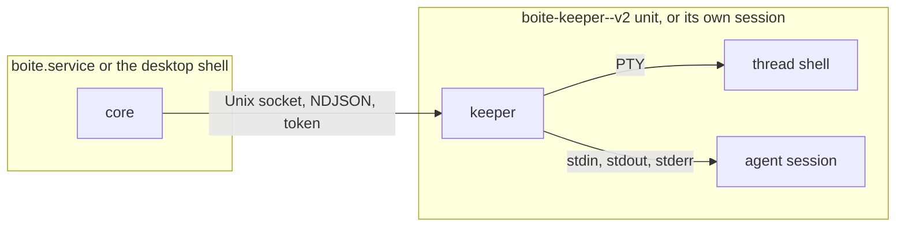

# Keeper

A thread's terminal can outlive the core that opened it. With `BOITE_KEEPER=1`
on Linux or macOS, the core asks a small process, the keeper, to start each
thread shell. The keeper holds the PTY, so a restart, an update or a crash of
the core leaves the shell running, and the next core takes it back with what
it printed meanwhile. With the same setting, the process of each thread's
agent session runs in the keeper too, on pipes: the core reads its output
through the socket and tells the keeper which bytes the journal has
committed. A restart still ends those turns; taking them back is the next
step. The setting is off by default.

The code is in `packages/core/src/keeper/`: `protocol.ts` (the wire),
`server.ts` (the keeper), `pipe-process.ts` (a process on pipes, in the
keeper), `client.ts` and `kept-child.ts` (the core's side), `kept-agents.ts`
(agent sessions and their offsets), `launch.ts` (how it starts).
`terminals.ts` uses it for thread shells. A sign-in terminal, a probe (models,
quota, sign-in), a title or side question and a shared execution still belong
to the core.

## Processes

- The keeper is the core's own executable: `keeper/entry.ts` from the
  sources, `dist/main.js --keeper` from the bundle, `boite-core --keeper` from
  the compiled binary, which `compiled-main.ts` sends to the keeper before the
  core loads.
- Under a systemd user service whose main process is the core, the keeper
  starts in a transient unit, `boite-keeper-<hash>-v<protocol>`, with the
  core unit's `MemoryHigh`, `MemoryMax` and `CPUWeight`. A process that only
  left the core's session would still be in the core's cgroup, and
  `KillMode=mixed` kills that cgroup when the core stops. Anywhere else it
  starts in a session of its own and writes to `<dataDir>/logs/keeper.log`.
- One keeper per data directory and protocol. Its socket is
  `$XDG_RUNTIME_DIR/boite/keeper-<sha256(dataDir)[0:12]>-v2.sock` (0600, the
  directory 0700), since a data directory deep in a home can pass the 104 or
  108 bytes a socket path may have. A `flock` on `<socket>.lock` keeps a
  second keeper of the same directory from starting.
- A core says `hello` with the token in `<dataDir>/keeper.json` (0600). One
  core is attached at a time.

## What is kept, and where

| What | Where | Bound |
| --- | --- | --- |
| The PTY master and the shell | keeper | until the shell exits or is released |
| The shell's last output | keeper, per shell | 256 KiB (`KEEPER_PTY_HISTORY_BYTES`) |
| Output for a core that does not read | keeper, per connection | 16 MiB, then that connection is dropped |
| An exit no core collected | keeper | 10 min |
| What the shell is (id, thread, cwd, shell, argv) | keeper, as the tag the core gave | none, a few hundred bytes |
| An agent's stdout the core has not acked | keeper, per agent | 8 MiB (`KEEPER_OUT_WINDOW_BYTES`), then it is not read until an ack: the agent waits on its write, nothing is lost |
| An agent's last stderr | keeper, per agent | 64 KiB (`KEEPER_ERR_BYTES`) |
| How much of an agent's stdout the journal holds the events of | core, `kept_processes.offset` | one row per agent process |

The core's own history of a shell is rebuilt from the keeper's 256 KiB when
it takes the shell back, masked as any output is.

## Restart

1. The stopping core lets go of its kept shells: they leave its registry with
   no exit recorded, and it closes the socket. The keeper keeps reading their
   output into the history.
2. The next core connects at startup without starting a keeper. For each shell
   the keeper holds whose thread exists and is not archived, it opens the
   session again, registers the pid, and sends `attach`. The keeper answers
   with the history as one `replay` frame, then live output in order.
3. Anything else it held is released: a shell of a thread gone since, one that
   exited while no core was attached, an older one under the same id.
4. `terminals.list` and `terminals.open` wait for that step, so a client that
   connects first sees the shell, not an empty tab.

A core with `BOITE_KEEPER=1` connects at startup, once the shells are
restored, starting a keeper if none listens, and stays attached while it
runs. A keeper with no core and nothing to hold exits after 60 s
(`KEEPER_IDLE_MS`).

## Agent sessions

`leasedSpawnChild` marks a session's own agent process with `keep` (its turn
and driver); `procs.spawnChild` hands such a launch to `kept-agents.ts`,
except a protected launch. It returns a `KeptChild` at once, as node's
`spawn` does: the driver and the Claude SDK read its `stdin`, `stdout`,
`stderr`, `pid`, `kill` and its `spawn`, `exit`, `close` and `error` events in
node's order. The pid, the registry entry and the `kept_processes` row come
with the keeper's `spawned` answer. A stop stops the process's group, which
the keeper starts detached, as the core does for its own agents.

Every stdout byte has an offset from 0. The keeper keeps what the core has
not acked; the core writes what the driver has read into the row's `offset`
in the transaction that commits the streamed parts (`StreamBuffer`'s commit
hook), the 500 ms one, not the 16 ms delta flush, which only moves text into
memory. Only after that commit does the core send `ack`, and the keeper drops
those bytes. Stdout that brought no text arms a commit as well, and past
4 MiB read and uncommitted (`FORCE_COMMIT_BYTES`) one runs at once, so an
agent printing fast does not wait for the timer at the 8 MiB window.

Once the process exited and both pipes ended, the next commit deletes its row
and releases it in the keeper. At startup a core deletes every row an earlier
core left and the shells' restore releases every kept process that is not a
shell. `state` stays null: it is for the driver's state at `offset`, which
taking a turn back after a restart needs.

When the keeper is not reachable at the moment of a launch, the agent starts
on the core's own pipes as before, a `keeper.agent-direct` warning is logged
once per outage, and the core connects again for the next one. A keeper that
dies during a turn ends its agents with no exit code: the driver sees its
process gone, the same path as a crash.

The echo driver starts no process by default. `[process]` sends the turn's
text from that point through a child, `drivers/echo-agent.ts`
(`--echo-agent` of the bundle and binary), and `[flood:N]` has it write N
characters as fast as its pipe goes.

## Stops

| Stop | Kept shells |
| --- | --- |
| Update (`/shutdown-for-update`, `/shutdown-if-idle`), `SIGTERM`, `SIGINT`, a crash | stay with the keeper |
| Desktop Quit (`POST /shutdown`), `core.shutdown` | end with the core |
| Closing the tab, archiving the thread | end, as before |

A keeper with live shells and no core for 10 min (`KEEPER_ORPHAN_MS`) ends
them and exits. `SIGTERM` to the keeper ends them at once.

When the keeper ends a shell (released, orphaned, or the keeper told to stop),
it first reads the shell's descendants and their process groups from `ps`,
then sends SIGHUP to each group and, 2 s later, SIGKILL to whatever of them is
left. A job an interactive shell put in a group of its own, `nohup` included,
goes with the shell. The keeper does not exit before that grace is over.

## Failure cases

- The connection closes while a core is attached, for instance because the
  core stopped reading for 16 MiB: the core connects again and attaches what
  the keeper still lists, asking only for the bytes after the last one it
  had (`attach.from`, the replay's `at`). More than the 256 KiB history
  missed leaves a gap before that history.
- The keeper dies: that reconnection finds no socket, and the core counts its
  shells as ended with no exit code; a core that was not attached finds
  nothing to restore.
- A thread archived or deleted while the keeper starts its shell: the shell is
  released as soon as it starts, and `terminals.open` refuses. A tab closed
  then: `terminals.close` waits for the start and closes the shell.
- A keeper of another protocol version: the socket name carries the version,
  so a core never reaches it. It ends its shells after its orphan delay.
- A wrong token or a second core: the keeper answers `refused` and closes.
- A frame without a line break past 64 MiB closes that connection.
- The keeper cannot start a shell: the core gets `failed` with the system's
  message, and `terminals.open` refuses with it.

## Limits

- Linux and macOS only. Windows keeps every process in the shell's job.
- An agent session runs in the keeper but still stops with the core, and
  resumes through the [restart handoff](restart-handoff.md).
- A process the keeper started is killed by the core's tree kill on Linux and
  by a signal to its group on macOS, as any terminal.

## Measured

`bun bench/keeper-restart.ts 3` on boite-m1, 2026-11-07, Bun 1.4.2: three
core restarts of one thread shell that prints 64 KiB while no core is
attached.

| | Keeper off | `BOITE_KEEPER=1` |
| --- | --- | --- |
| Shell pid after each restart | a new shell (4 pids for 3 restarts) | the same pid |
| Output the next core had | 0 bytes | 65,713, 131,508, 197,303 bytes |
| Output printed while no core ran | lost | kept |
| `terminals.open` after a new `Core` | 14 to 16 ms | 15 to 17 ms |
| Keeper RSS holding one shell, from the sources | none | 32 MB |

The compiled binary's keeper, idle: 75 MB RSS, of which 52 MB are pages of
the binary itself, shared with the core in the page cache, and 22.5 MB its
own.

`BOITE_KEEPER=1 bun bench/keeper-agent.ts 64 20` on boite-m1, 2026-11-07,
Bun 1.4.2: the echo driver's child started by `procs.spawnChild` with `keep`
(the keeper) and without (the core's pipes), in one core.

| | Core's pipes | Keeper |
| --- | --- | --- |
| First stdout byte after `spawnChild`, median of 20 | 13.46 ms | 13.72 ms |
| 64 MiB of stdout, median of 3 | 216.5 MiB/s | 215.1 MiB/s |
| An echo turn `[flood]` of 8 MiB to idle, median of 3 | 155 ms | 185 ms |

## Verification

`packages/core/test/keeper.test.ts` restarts a core on the same data directory
and checks that the thread shell keeps its pid, that the next core lists it,
has its earlier output and what it printed between the two cores, and that it
answers input; then that `POST /shutdown`'s stop ends the shell. The first
test fails on a core without the keeper: the shell is gone after the restart.
The same file checks that a core dropped while it did not read takes its
shell back with the end of 30 MB it missed, that ending a shell ends its
`nohup` job, and that closing a shell or archiving its thread while it starts
ends it.

`packages/core/test/keeper-agents.test.ts` runs an echo `[process]` turn with
the keeper on. While the turn waits, the agent's parent is the keeper, its
row names the thread, turn and driver, and its offset, the keeper's acked
offset and the keeper's end are all the bytes the child printed, whose text
is committed; after the turn the row is gone, the keeper no longer lists it
and the process exited. It fails when the launch is not marked `keep`. The
same file streams one and a half windows of stdout through a turn, which
only finishes if commits ack it, and checks that a keeper the core cannot
reach leaves the agent on the core's pipes with the warning.
