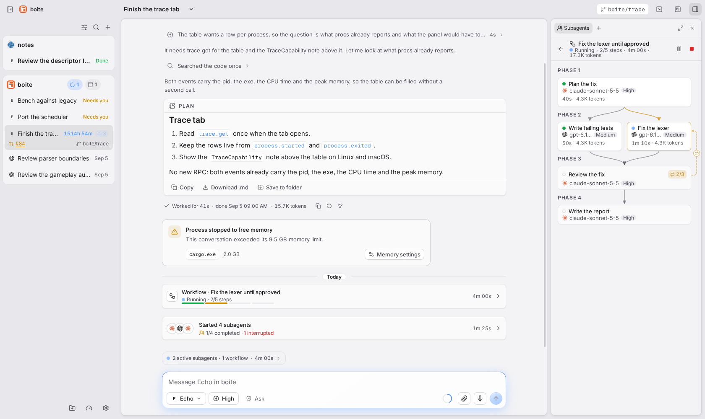

# Workflows

A workflow is a plan of steps that Boite runs for a conversation. Each step is
a child agent, and a step starts once every step it depends on has ended. Use
one when a task has a fixed shape: scan, then review each file, then fix, then
report.

No model sits in the middle deciding what runs next, so a plan behaves the
same whichever agent wrote it or runs its steps. Nothing has to be turned on
first.

## Run one

1. Ask the agent for a workflow, for example "run a workflow that reviews each
   changed file of the parser, fixes what the reviews confirm, then writes a
   report".
2. The agent writes the plan and starts it. Boite checks the whole plan before
   anything starts, and refuses a bad one with the field named.
3. The run opens in the Subagents tab of the [right panel](panel.md), and the
   chat shows a Workflow card where it started, with its status, steps done out
   of the total and the elapsed time.
4. When the run ends, its results come back to the conversation as one
   message.

The agent stays free to answer with subagents or plain work when that fits
better: a workflow is a tool it may reach for, not an obligation.

## What a plan can say

| A step can | Example |
| --- | --- |
| Wait for other steps | Write the report after the fixes |
| Run once per item of a list | Review each file the scan returned |
| Run only if a condition holds | Fix only when the reviews found bugs |
| Repeat a group of steps | Fix, then review, until the review approves |
| Return a fixed shape of data | A list of bugs, each with a line and a text |
| Run on another model or level | A Codex reviewer at high effort |
| Work in its own Git worktree | A fix on a branch of its own |
| Run on another machine of your group | A step in that machine's copy of the project |

A step without a model runs on the conversation's agent, account, model and
reasoning level. The agent can add steps to a run that is still going, after
it read the first results.

## Read the graph

- The run draws top to bottom: one row per phase, the steps of a phase side by
  side, an arrow down from each step to the steps waiting for it.
- A card shows the step's status, its model, its elapsed time and its tokens.
  A step that runs once per item shows `done/total` and a segmented bar.
- A loop draws a dashed arc back to the step it starts from. It is amber while
  the loop runs, green once its condition held, red once it ran out of rounds.
  The closing step shows the round, such as `2/3`.
- A phase with more steps than fit turns the run into a plain list of phases.
- The header totals the reported tokens. Tokens still being generated are not
  counted.

Click a step run by one agent to open its conversation. A step with several
executions opens its detail: dependencies, condition, loop, each execution and
its output, with Open conversation. Back to the graph returns to the run.

## Pause, stop and retry

- Pause starts nothing new; steps already running finish. Resume picks up.
- Stop asks first, then stops the running steps. The rest never starts and
  finished steps keep their results.
- A failed step stops new launches and the agent hears of it at once. Retry
  runs the failed step again in its own conversation, with the previous error.
- Stopping or archiving the conversation stops its runs too.
- An update or a restart from the app hands the run over: the next start of
  Boite runs the cut steps again. After a crash, or when Boite stayed stopped
  for more than an hour, running runs pause until you or the agent resume
  them.
- A phone can follow a run and stop it. Pause is not offered there.

## Templates

A plan can be kept as a template under a name and started again later.
Templates are saved, listed and started by the agent from the command line,
not from the panel: ask the agent to save the plan, or to start a template by
name. An agent never replaces a template already saved under that name.

## Limits

| Limit | Default | Maximum |
| --- | --- | --- |
| Steps in a plan | | 32 |
| Executions in a run, items and loop rounds included | 24 | 64 |
| Rounds of a loop, the first included | 3 | 10 |
| Executions running at once | 3 | 8 |
| Unfinished runs per conversation | | 3 |
| A step's task | | 12,000 characters |
| Answer kept per execution | | 4,000 characters |

- Steps share the conversation's folder unless a step has its own worktree, so
  parallel steps need distinct files.
- Workflows run even when subagents are turned off for the conversation. Only
  a paused team holds them.
- The agent can pause, stop and retry only the runs it started. You control
  all of them.

## Going further

- [Subagents](subagents.md): children, model profiles and worktrees.
- [Council](council.md): several models review one request.
- [Panel](panel.md): the right panel and its tabs.
- Technical reference: [workflows](internals/workflows.md).
